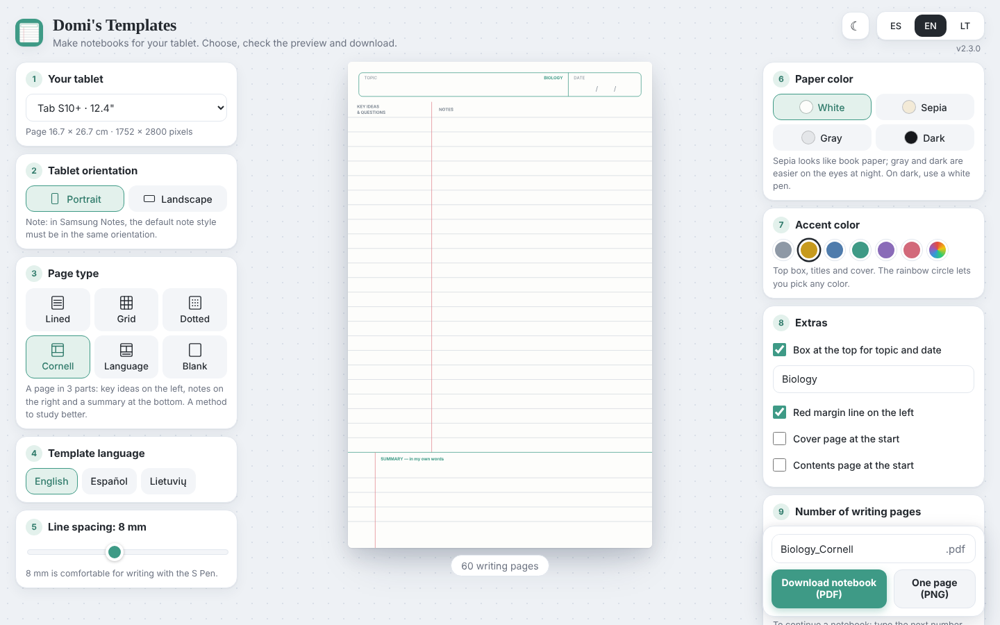
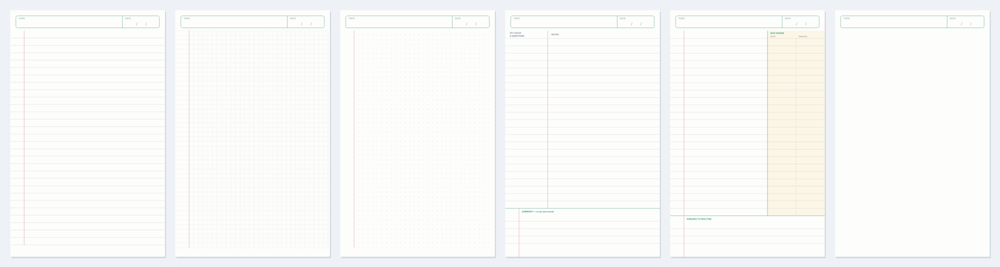
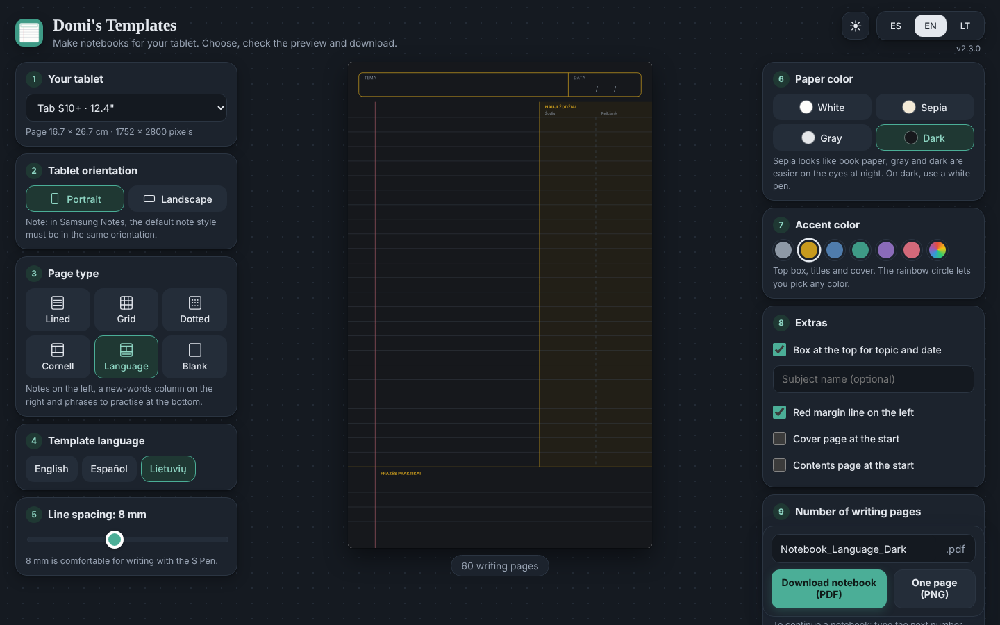
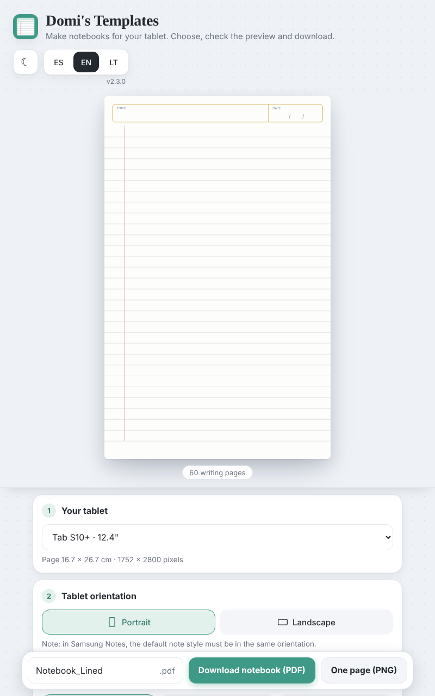

<div align="center">


# Plantillas de Domi

**Notebook templates for Samsung Notes, sized to the real screen of your Galaxy Tab.**
Lined, grid, dotted, Cornell and language-learning pages — as a sharp vector PDF, ready to import.

[**Open the app →**](https://djeldes75.github.io/plantillas/)

[](https://github.com/Djeldes75/plantillas/actions/workflows/ci.yml)
[](LICENSE)




</div>

## Why

Notebook templates you find online are usually A4 or Letter, so on a tablet they appear with grey bars or
get stretched. This app draws every page at the **exact physical size of your tablet's screen**, so a notebook
imported into Samsung Notes fills the screen edge to edge and the line spacing is real millimetres.

## Features

| | |
|---|---|
| **6 sheet styles** | Lined, grid, dotted, blank, Cornell (cues + notes + summary) and language (notes + new words + phrases) |
| **Real tablet sizes** | Galaxy Tab S9 / S9+ / S9 Ultra, S10+ / S10 Ultra, S11 / S11 Ultra, S12+ / S12 Ultra, and A4 — portrait or landscape |
| **Your look** | White, sepia, gray or dark paper; any accent colour; line spacing from 5 to 12 mm |
| **Full notebooks** | Optional cover (4 designs), contents page and page numbers that can start at any number to continue a notebook |
| **Sharp at any zoom** | Hand-written vector PDF with vector text (Inter); single-page PNG export too |
| **3 languages** | Interface and printed labels in English, Español and Lietuvių |
| **Comfortable** | Light and dark theme, big touch targets for the S Pen, remembers your choices |
| **Private** | Runs entirely in your browser: no account, no server, no analytics, no cookies |

<div align="center">

</div>

<table>
<tr>
<td width="62%"></td>
<td width="38%"></td>
</tr>
<tr>
<td align="center"><sub>Dark theme</sub></td>
<td align="center"><sub>Tablet, portrait</sub></td>
</tr>
</table>

## Install

The app is a Progressive Web App: it installs from the browser, gets its own icon, opens full screen,
works offline and updates itself.

- **Tablet (Android):** open the [app](https://djeldes75.github.io/plantillas/) in Chrome → **⋮ → Add to home screen → Install**.
- **Computer (Chrome / Edge):** open the app → click the **install icon** at the right of the address bar.

## Use it with Samsung Notes

1. In Samsung Notes: **☰ → Settings → Default note style** — set it to the same orientation as your notebook (portrait or landscape).
2. In the app, pick your tablet, sheet style and options, then **Download notebook (PDF)**.
3. In Samsung Notes: **⋮ → Import PDF** and choose the file.

**Continue a notebook that ran out:** set *Start numbering at* to the next page (e.g. 61), untick cover and
contents, download, then import the PDF **inside** the existing note — the pages are added at the end.

## How it works

No libraries and no build step. The PDF is written byte by byte in the browser:

- Page geometry is computed in millimetres from each tablet's resolution and diagonal (`js/geometry.js`).
- The same drawing code renders the live preview, the PNG and the PDF, through a small canvas-like
  PDF backend (`js/draw.js`, `js/pdf.js`).
- Text is drawn from embedded glyph outlines of the Inter typeface, so it stays vector and identical on
  every device (`js/font.js`, `js/text.js`); an invisible text layer keeps page numbers searchable.
- Streams are compressed with the browser's built-in `CompressionStream`.

## Project structure

```
index.html              page + Content Security Policy
css/styles.css          interface styles (light / dark, tablet / computer)
js/theme.js             applies the light or dark theme before the page paints
js/data.js              devices, sheet styles, colours, translations
js/geometry.js          page measurements and row layout
js/font.js              Inter glyph outlines (generated data)
js/text.js              vector text engine
js/draw.js              sheets, cover and contents page
js/preview.js           live preview
js/pdf.js               vector PDF writer
js/app.js               interface, saved options, downloads, start-up
sw.js                   offline cache
manifest.json, icons/   installable app
tests/verify.js         automatic test suite
tools/build-single.js   builds a one-file version into dist/
docs/screenshots/       images used in this README
```

## Development

```bash
npm install
npx playwright install chromium     # once
npm test                            # needs qpdf, poppler-utils and python3-pil
npm run build:single                # dist/plantillas-single.html
```

The test suite (`tests/verify.js`) serves the app locally and checks, among other things:

- **Layout:** 3,600 combinations of tablet, orientation, style and spacing. It checks that rows are even,
  lines never cross text and nothing leaves the page.
- **Covers:** 256 cover combinations.
- **Files:** every PDF is checked with `qpdf` and `pdfinfo` (size, page count, numbering), and every PNG's pixel size is checked.
- **Translations:** they are complete in all three languages.
- **Interface:** the tabs, the dark theme and the saved options work, and damaged saved data is ignored.
- **Security:** the Content Security Policy blocks nothing, and the console stays free of errors.

Every push to `main` runs the tests on GitHub Actions; the site is deployed to GitHub Pages **only if all of them pass**.
When you change an app file, bump `VERSION` in `sw.js` and `APP_VERSION` in `js/app.js`.

## Security and privacy

Everything happens on your device. A strict Content Security Policy allows code, styles and images only from
this site, there is no third-party code, and the offline cache stores only this site's files.
See [SECURITY.md](SECURITY.md) to report a problem privately.

## License

App code: [MIT](LICENSE) © 2026 Domi.
Inter font outlines: SIL Open Font License 1.1 — see [THIRD_PARTY_NOTICES.md](THIRD_PARTY_NOTICES.md).
Changes: [CHANGELOG.md](CHANGELOG.md).
